

<!-- Hero Banner & Live Portfolio Trigger -->
<a href="https://shrri-dharshan-portfolio.vercel.app" target="_blank">
  <picture>
    <source media="(prefers-color-scheme: dark)" srcset="./dark.svg">
    <source media="(prefers-color-scheme: light)" srcset="./light.svg">
    
  </picture>
</a>

 

<!-- Real-Time Metrics & Badges -->

  
  
  
  
  

<!-- Identity Metadata Badges -->

  
  
  
  
  

<!-- Social & Communication Channels -->

  
  &nbsp;&nbsp;
  
  &nbsp;&nbsp;
  
  &nbsp;&nbsp;
  

---

<!-- 01 // ABOUT -->



---

<!-- 02 // PHILOSOPHY -->


---

<!-- 03 // JOURNEY -->


---

<!-- 04 // STAR PROJECTS -->

<a href="https://github.com/shrridharshan27/CorrectiveRAG" target="_blank">
   14.6% (-53%), accuracy +11.2 pts. Real-time document chunk relevance evaluation, autonomous fallback web search, and hallucination guardrails.">
</a>

  

<a href="https://github.com/shrridharshan27/SecureDoc-LI" target="_blank">
  
</a>

  

<a href="https://github.com/shrridharshan27/meeting-summarizer" target="_blank">
  
</a>

  

<a href="https://github.com/shrridharshan27" target="_blank">
  
</a>

  

<a href="https://github.com/shrridharshan27/biochar-mrv-tracker" target="_blank">
  
</a>

  

---

<!-- 05 // CREDENTIALS -->

<a href="https://shrri-dharshan-portfolio.vercel.app" target="_blank">
  
</a>

  

---

<!-- 06 // TOOLKIT -->


---

<!-- 07 // LIVE CINEMATIC PORTFOLIO -->

  
Step through my cinematic scrollytelling developer portfolio featuring a 60fps canvas ambient engine, interactive slide-over architecture drawer, and live verified certificate viewer:

  

---

<!-- 08 // METRICS & COMMIT LOG -->

  
  

  

  

  

---

<!-- 09 // HIDDEN TRIVIA -->

<b>🤫 Things you won't find on my résumé</b>

 

- 🏋️‍♂️ **VP of Fitness Club @ VIT Chennai:** Lead health workshops and strength training regimes for 100+ active university members. Physical discipline and mental grit directly power my software architecture stamina.
- 📜 **Oracle Certified Generative AI Professional:** Mastered LLM architectures, fine-tuning, and RAG pipelines, scoring **88%** on the Oracle Cloud Infrastructure exam (Credential ID: `330277621OCI25GAIOCP`).
- 🌾 **Stoichiometric Pyrolysis & Climate dMRV:** Formulated biochemical pyrolysis equations (`mass × 0.60 × 3.67`) and built cryptographic carbon ledgers with sequential SHA-256 hash chains to empower smallholder agroecosystems.
- 🛡️ **Zero-Trust Obsessive:** I believe security is never an afterthought—whether deriving keys with 100,000 PBKDF2 rounds, verifying TOTP authenticators, or enforcing HTTP 405 immutable database invariants.
- ⚡ **Why I Care About Latency:** Once experienced an audio transcription take 45 seconds for a 2-minute voice clip; rebuilding it with Groq LPUs for ~8-second 30-minute turnarounds changed how I think about user experience forever.

---

<!-- 10 // CONNECT & FOOTER -->

  
  &nbsp;&nbsp;
  
  &nbsp;&nbsp;
  
  &nbsp;&nbsp;
  

<a href="https://shrri-dharshan-portfolio.vercel.app" target="_blank">
  
</a>

  Crafted with mathematical precision, unslop aesthetic, and relentless software reliability. © 2026 Shrri Dharshan D R.

